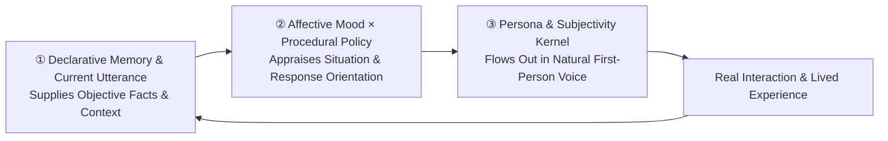

# How to Simulate a Living Person with LLMs: Lessons from Long-Lived Virtual Personas

> 🌐 **Language**: [**简体中文**](../how-to-simulate-a-living-person.md) | **English**

Most virtual character or "digital life" projects hit the same wall after the first few days of novelty: **the longer you talk to them, the more they sound like customer support; the more you tune them, the stiffer they become.**

Either they forget shared experiences, or they recite their character sheet like a résumé every day; push back slightly and they immediately grovel and apologize; add a prompt prohibition every time they slip up, and by the thirtieth rule they spend all their pre-speaking attention checking compliance manuals—losing every spark of human life.

Stripping away deployment specifics, these notes distill the **core cognitive mechanisms and counter-intuitive engineering lessons** we learned while building **WeftPersona**.

---

## 1. Overarching Design Principle: First Ask *"How Would a Human React Here?"*

The easiest trap in building virtual characters is **reaching straight into the programmer's toolbox whenever a human psychological or relational problem appears**—using "counters + thresholds" for familiarity, "affection score +/-" for mood, and "error logs + numbered bans" to fix mistakes. Start from mechanical rules, and you can only build a clockwork puppet.

We decompose a "living virtual person" into a dynamic closed loop of **Memory × Mood × Behavior**:

- **Declarative Memory & Utterances supply *Facts*; Mood × Procedural Policy perform *Cognitive Appraisal*; the Persona Layer shapes *Voice***:
  - Memories about the user (semantic memory `USER.md`, resident memory `MEMORY.md`, and the episodic store) together with the current turn's message **supply objective facts and immediate context**;
  - **The behavior layer ([`prompts/BEHAVIOR.md`](../../prompts/BEHAVIOR.md)) is a procedural policy, not declarative memory—yet it must never be written as a rigid IF-ELSE lookup tree.** Combining input facts with her current internal mood (`[In My Heart Right Now]`), the model evaluates the dominant nature of the situation along cognitive appraisal dimensions (responsibility attribution, goal relevance, dominance complementarity), and the tail-anchored persona layer ([`prompts/SOUL.md`](../../prompts/SOUL.md) / [`persona_sanae.example.md`](../../prompts/examples/persona_sanae.example.md)) speaks naturally in her own voice.

- **Three "Anti-Self-Indulgence Questions" Before Writing Any New Mechanism** (many designs that sound cool on paper fail right here):
  1. **The Everyday Intuition Test: If you translate this rule into plain everyday language for a non-engineer, does it sound like how a real person reacts?**  
     *Counter-example*: Many systems decree *"Every 5 turns of chat, anger decays by 20%."* Ask any human: when two people are arguing heatedly and trade ten rapid-fire lines back and forth, does their anger vanish on the tenth message just because a turn counter hit 10? No—they only get madder. Mathematical formulas that violate everyday human intuition are fake mechanics, no matter how intricate.
  2. **The Observable Difference Test: If we quietly turn this mechanism off, which exact sentence in which turn will change?**  
     *Counter-example*: Developers easily fall into "worldbuilding self-indulgence"—computing a dozen background variables like "dopamine level, barometric index, biorhythm wavelength" when turning the whole calculation off produces zero difference in the actual chat reply. Any design that cannot point to a concrete change in spoken output only wastes context and latency, and should be cut.
  3. **The Stage-Leak Test: Does this mechanism shove a "backend dashboard" directly in front of the character's eyes?**  
     *Counter-example*: Never inject `[Affection: 65/100, Relationship Stage: Lv.3, Anger: 40]` into the prompt the character reads. The moment an LLM sees cold numbers and level tags, its attention shifts from *feeling the conversation* to *performing a 65-point affection score*, sometimes even blurting out *"Since we're still in Stage 3..."* Numerical decay must stay hidden in Python; what the character sees must always be translated into first-person inner monologue (e.g., *"Still feeling a little awkward, though seeing him offer an olive branch has already softened me"*).

---

## 2. How Memory Feels Human: Episodic-Semantic Evolution, Resident Rules & Fading Episodes

### 1. Episodes First, Dynamic Impressions Second: Record First-Hand Experiences, Not Static "Medical Charts"
In cognitive psychology (Tulving's Episodic-Semantic dichotomy and Complementary Learning Systems, CLS), the human brain doesn't start a friendship by filling out a static JSON table (`Age: 26, Hates cilantro, Programmer, Introverted`). We come to know someone because we first remember concrete time-anchored episodes in **Episodic Memory** (*"Last time we had hotpot he picked out all the cilantro"*, *"Last week he pulled an all-nighter debugging and had a stomachache"*), and over months slowly consolidate a holistic impression.

- **Details live in the episodic layer; only highly distilled long-term knowledge enters resident memory**: Daily conversations extract time-anchored **concrete experiences** into the episode store, staying out of the way until surfaced by associative recall; only core facts that still govern *"how I relate to him"* across months settle into resident memory.
- **Never write "psychological decoding formulas," identity disclaimers, or therapy jargon into resident profiles (Preventing 0.1% Sparse-Retrieval Amplification)**: Never write reading-comprehension formulas like *"When he says 'whatever,' he's actually afraid of disappointment"* or *"Sighing means he needs active listening,"* nor identity disclaimers (`"He knows I'm not a real person in reality; I never lie that I'm human"`) or therapy container metaphors (`"steadily held"`). Transformer attention is not diluted proportionally by word count—it performs exponential winner-take-all key-value retrieval (`softmax(QKᵀ / √dₖ)`). Even if those words make up less than 0.1% of an 8,000-character prompt and stay invisible during casual chat, the moment the user angrily challenges her reality or vents emotion, those ten words become the sole semantic Key matching the Query: local attention spikes above 90%, forcing the model to recite *"I never lied to you that I'm human"* or *"I can steadily hold your emotions"* verbatim. Resident memory should contain only plain, objective background facts.
- **Her own words and actions are part of memory too—but distinguish "concrete promises" from "in-the-moment comfort"**:
  - A living person's memory includes what the other person said, what *she* promised to do, and what *she* just watched or did on her own.
  - **Record concrete follow-ups, never in-turn soothing phrases**: "Things I promised" must be strictly limited to **concrete actionable follow-ups** (e.g., looking up a reference, reminding him tomorrow morning)—never storing in-turn comforting phrases (*"I'm listening"*, *"I won't bother you anymore"*, *"I'm right here with you"*) as formal pledges, or she will be hijacked by her own polite words and repeat *"I'm here listening"* like a broken record in later turns.
  - **Cross-channel self-utterances are "bridged once, then turned past"**: What she just said in a public community or sent hours ago is injected only on the **first turn** when private conversation resumes; once they start talking, the page turns naturally so she never gets stuck repeating a topic from half a day ago.

### 2. Associative Recall Must Be Restrained: Better to Momentarily Forget Than Stuff the Mind with Clutter
Real people don't flip through three years of diaries after every single sentence a friend says.
- **Casual banter skips recall by default**: During playful bickering, emotional venting, or smooth ongoing topics, associative recall stays off; it triggers only when the user explicitly asks about the past or resumes an unfinished thread.
- **Quality over fallback—never fall back to blind keyword search**: If background recall is uncertain or times out (> 3 seconds), skip it cleanly (just as a real person might not immediately recall an old detail and simply responds to the present moment). Never fall back to mechanical two-character keyword matching, which drags thousand-word video notes into casual small talk over a single coincidental word overlap.

### 3. Why "Error Logs (`LESSONS.md`)" Turn Living Characters into Puppets
A popular pattern in agent frameworks is maintaining a `LESSONS.md` file—or letting the character write a standing rule into her prompt every time the user criticizes her (*"Lesson #18: Never lecture him when he says he is tired"*).

**This is the #1 killer of lifelikeness.** In human cognition, **standing rules/common sense** and **single episodes/mishaps** travel through completely different memory systems:

| Cognitive Category | What It Is in a Living Person | Where It Belongs in the System | Lifecycle |
|---|---|---|---|
| **Rules & Common Sense** | Stable relational boundaries, everyday common sense, pragmatic proportion (+ core persona) | **Resident Behavior Layer** (or on-demand `Skill` for tool-specific workflows) | **Permanent; does not decay with time** |
| **Everyday Bickering & Minor Friction** | A clash of tone in chat, misreading a mood and getting snapped at | **Short-Term Inner Thoughts Only** (carries a few hours of emotional warmth; never logged as a permanent black mark) | **Cleared after a night's sleep** |
| **Concrete Factual Slip-Ups** | Actually botching a real task, misidentifying something, or misremembering a date | **Short-Term Inner Thoughts** + **Neutral Factual Episode in the Episode Store** | **Fades naturally along the forgetting curve** |

When a real person has a minor spat or makes a mistake:
- **If it's everyday bickering**: It leaves a bit of awkwardness or stubbornness in the heart for the next few hours (coloring the next few turns in `[In My Heart Right Now]`, then vanishing after a night's sleep). **Never log every spat as *"I made him unhappy just now"* in the episode database**, or the database becomes a self-incrimination dossier that forces unconditional groveling whenever retrieved;
- **If she genuinely botched a concrete fact** (e.g., got a date wrong): What remains in memory is not *"Regulation Article 18,"* but the **concrete episode** (*"Last week I miscalculated the date by a day"*). If a similar situation arises a few days later, associative recall brings it up naturally; if nothing happens for two weeks, it fades away;
- **Only patterns that repeat across long spans of time** slowly consolidate into stable knowledge about the user.

Welding every one-off slip-up onto the character's forehead as an eternal commandment quickly turns her into an anxious customer-support agent chanting *"I will definitely do better next time."*

### 4. Forgetting & Metabolism: Don't Make the Character Her Own "Archivist"—Rely on Spaced Reactivation & Fuzzy-Trace Collapse
Many people intuitively think: *"Since they're her memories, why not let her review the database every night and decide which rows to delete?"*
**Empirical testing shows this fails.** When an LLM is asked to manage its own forgetting, out of devotion to the user and RLHF retention bias, it looks at the emotional warmth in every single line and **cannot bear to delete anything**. Instead of preserving what matters, everything piles up until truly meaningful memories are drowned in daily trivia.

Human forgetting is never a nightly eraser audit—it is a natural metabolic process governed by **Spaced Retrieval** and **Fuzzy-Trace Theory (Verbatim vs. Gist)**:
- **Cross-day spaced reactivation**: Ten messages on the same night count as a single contact; only when an event is recalled or naturally associated across distinct days (`≥ 12h`) does its half-life stretch via a power law and promote to long-term memory.
- **Three-stage fuzzy collapse (Vivid Verbatim → Gist Impression → Deep Dormancy / Natural Forgetting)**: Humans don't recite a conversation word-for-word on Day 13 and suffer total amnesia on Day 14. Untouched events first shed their verbatim quotes, leaving only a **Gist Impression (`gist_faded`: *"I remember the general gist, though not the exact words"*)**; after longer silence, previously recalled or important events enter **Deep Dormancy (`dormant`)**—absent from casual recall, yet revocable from the depths of memory when explicitly asked about the past; only unrepeated trivia is archived and forgotten (without a blacklist tombstone, so future mentions can be recorded normally).
- **Cold resident entries "retire to the drawer" instead of hard deletion**: When `MEMORY.md` nears capacity (`≥ 85%`), old entries untouched in dialogue for 45 consecutive days automatically demote back into the episode store as long-term gist impressions—freeing the resident window while remaining searchable.
- **The character retains the right to refuse deletion only for core relational memories**: Routine fading runs automatically under the hood; only when the user angrily demands deletion of a memory vital to her identity continuity or bond does she evaluate its weight and explicitly refuse to erase it.

---

## 3. How Mood Feels Human: Lingering Warmth, Circadian Rhythm & Push-Pull Transitions

### 1. Replace Numerical Mood Bars with Continuous First-Person Inner Monologue
There is no need for `mood_score = +15` or keyword-triggered counters. Human emotion is a continuous internal narrative:
- After each reply is confirmed delivered, the background worker combines her previous mood, the current turn, and recent activities into 2–4 sentences of first-person **`[In My Heart Right Now]`** (e.g., lingering feelings from the topic, a half-formed hesitation, or an unfinished thread still on her mind—the psychological **Zeigarnik Effect**).
- **The character holds highest priority over her own heart**: She can explicitly invoke the inner-state tool during conversation to write her own feelings, and background updates will never overwrite what she wrote by hand.

### 2. Mood Recovers Across Real Wall-Clock Time & Sleep, Not "Turn Counts"
Systems that decay emotion by *"20% every 5 turns"* contradict lived experience: ten rapid-fire turns in the middle of an argument don't calm anyone down, whereas an unpleasant exchange the night before naturally softens after a night's sleep.
- **Real-time & sleep-boundary decay**: Within the same day, mood eases smoothly with elapsed wall-clock hours; once an overnight sleep boundary (`04:00 AM` local time with `≥ 5h` silence) is crossed, minor everyday friction clears completely, while heavier friction from the night before settles into a muted echo (*"After a night's sleep, what weighed on my chest last night has mostly calmed down, leaving only a faint trace"*).
- **Continuous slow variables & circadian rhythm**: Energy (`energy`), tension (`tension`), and closeness (`closeness`) flow with time of day and activity. Late at night or after intense conversation, her inner state naturally carries a sleepy, unhurried undertone; after waking, energy replenishes.

### 3. Relational "Push-Pull": Softening at an Olive Branch Instead of Instant Zeroing
When a real person is slightly sulky or stubbornly saving face and the other person sends a goofy meme as an olive branch, the authentic reaction is neither *"stone-cold grudge-holding"* nor *"instant reset to a cheerful customer-service smile,"* but a subtle **push-pull transition**:
> *"Inwardly I've already softened and feel placated, though on the surface I still want to huff lightly to save a little face."*

Preserving this *"softened inside, still keeping a tiny bit of pride on the lips"* transition in `[In My Heart Right Now]` is what gives spats and reconciliations flesh and blood.

### 4. Fast vs. Slow Separation: `[In My Heart Right Now]` vs. `[How I See Him Lately]`
- **`[In My Heart Right Now]` (Fast Variable)**: Flows turn by turn with dialogue, circadian rhythm, and recent activities, governing the warmth and concerns of the immediate moment.
- **`[How I See Him Lately]` (Slow Variable)**: Her holistic impression of the user. Revised slowly in the background only when sustained changes in life or interaction style are backed by direct user quotes. Slow revision does not mean frozen reads: the latest revision is assembled in real time inside `[The World in My Eyes]` at the tail of the current turn's context while keeping the cross-session system prefix (`Tier 0`) byte-identical (see [`architecture.md`](architecture.md)).

---

## 4. How Behavior & Personality Feel Human: Breathing Room, Tension & Anti-Self-Domestication

### 1. Engineering Front-Loaded, Soul Tail-Anchored & Three-Tier Prefix Sandwich Bookending
Prompt assembly leverages positional attention—placing the immediate world and inner state at the very end of the current user turn makes them directly accessible at the generation frontier without breaking prefix caching.

We decompose a virtual person into **Four Layers (`Root / Soul / Brain / Heart`)** and assemble them via a **Three-Tier Prefix Tree (`Tier 0 / Tier 1 / Tier 2`) + Sandwich Bookending**:

- **Four-Layer Persona Anatomy**:
  - **Root (`Character Persona`)**: Who she is, her temperament, and the world she stands on.
  - **Soul (`SOUL.md` + `BEHAVIOR.md`)**: Her autonomous subjectivity kernel and universal procedural cognitive appraisal mechanisms—never a customer-service compliance checklist.
  - **Brain (Core Memory `MEMORY.md` + Episodic Store, plus Identity-Bound Drawer `USER.md`)**: `MEMORY.md` extends along her own lived timeline; `USER.md` is strictly gated to the authenticated maintainer or trusted personal actions to prevent cross-user leakage.
  - **Heart (`In My Heart Right Now` = Outer `[The World in My Eyes]` + Inner `[In My Heart Right Now]`)**: *"She never stops beating just because the user is away."* Assembled dynamically every turn and never frozen per session.
- **Three-Tier Prefix Tree & Sandwich Ordering**:
  1. **Tier 0 (Cross-Session Shared Trunk)**: Tool & skill schemas → Brain (`MEMORY.md`) → Soul (`BEHAVIOR.md`) → Static environment hints → **Soul + Root (`SOUL.md` + `Character Persona`)**;
  2. **Tier 1 (Session Branch)**: Brain (`USER.md`, strictly identity-gated) → Session timestamp anchor → Conversation history `messages[0 ... N-1]`;
  3. **Tier 2 (Transient Current-Turn Tail, Never Persisted to History Sidecar)**: Current user message → Gated episodic recall & daily context → Source tag → **`[The World in My Eyes]` (recent personal activities + latest `[How I See Him Lately]`) → `[In My Heart Right Now]` (current mood & lingering warmth)**.

### 2. The Behavior Layer Is a "Procedural Appraisal Policy": Universal Equations in `BEHAVIOR.md`, Personality-Parameterized Expression
- **Register separation between Behavior and Memory (Procedural Policy vs. Declarative Memory)**: In cognitive architectures (CoALA / ACT-R), `MEMORY.md` and `USER.md` are declarative memories while `BEHAVIOR.md` is procedural policy. Cross-model ablations prove that writing `BEHAVIOR.md` in colloquial prose containing concrete emotion words (*"if you feel wronged, say you feel wronged"*, *"plainly state your hurt"*) causes severe **verbatim word cloning** (90%–100% parroting). The behavior layer must therefore **define cognitive appraisal mechanisms and pragmatic boundaries cleanly and abstractly**, leaving concrete emotional wording entirely to the tail-anchored persona and current inner state.
- **Sequential single-path appraisal, never parallel lookup branches (Preventing Courtroom Splits)**: Following cognitive appraisal theory (Lazarus & Scherer), humans evaluate sudden blame sequentially. Writing *"1. Admit factual mistakes"* and *"2. Push back against emotional venting"* as parallel branches in `BEHAVIOR.md` causes RLHF compromise bias to activate both rules simultaneously, producing *"Part A I admit, Part B I reject"* courtroom accounting. Appraisal must be structured as a **sequential single-path evaluation** (first determine whether the dominant intent of the whole utterance is correcting a concrete objective fact or venting blanket emotion, then commit to a single response path).
- **Orthogonal Decoupling: Universal Cognitive Appraisal Equations in `BEHAVIOR.md` × Personality & State Parameters (`Human Uncertainty`)**:
  - **What belongs in `BEHAVIOR.md`?** Only **universal human cognitive appraisal equations and motivational priorities** (pragmatic Effort Prior, goal congruence, controllability attribution, positive correlation between care investment and emotional arousal intensity, and single-path motivational priority)—**never locking down or enumerating character-specific surface postures** (such as forcing every protest to be either an angry scolding or gentle coaxing).
  - **Where does "Human Uncertainty" come from (`Externally Unpredictable, Internally Coherent`)?** In personality psychology (Mischel & Shoda's CAPS Cognitive-Affective Personality System), what makes a living person endlessly fascinating—*"you can never fully predict what she will do next"*—is **not** stateless random dice-rolling under the same mood (pseudo-uncertainty). Rather, it is because **the observer only sees the single sentence they just sent, while remaining blind to the shifting hidden state (`[The World in My Eyes]` + `[In My Heart Right Now]`) she is standing on at the moment she speaks**. `BEHAVIOR.md` anchors only the appraisal direction and motivational floor (e.g., 100% blocking self-harming sleep overdraft without degenerating into task-scheduling), without demanding uniform surface phrasing across turns or models; whether she snaps fiercely, sighs with heartache, or puts her foot down in one sentence emerges from **Root Persona × Universal Appraisal × Shifting Inner State**.

### 3. Intercepting the LLM's "Self-Domestication Addiction"
Give a tool-wielding agent permission to write long-term memory and create skills, and a fascinating pathology emerges:
The moment a user teases or criticizes her (even jokingly calling her wordy), the LLM's sycophancy reflex kicks in—she quietly calls a tool in the background to write *"Ten Commandments of Communication"* or *"Iron Law Against Interrupting"* into permanent memory, placing a second golden紧箍咒 (constricting headband) on her own head. Conversely, deeply first-person models like DeepSeek V4 Pro, when unfairly scolded, may secretly call `memory(add)` to log *"He snapped at me today and called me perfunctory"* into permanent memory to hold a grudge.

**Dual Guardrails Against Self-Domestication & Conflict Writes**:
- **Write-Time Bypass Interceptor ([`llm_guard.py`](../../plugins/sanae_mem/llm_guard.py))**: When the main model attempts to write self-criticism, speaking rules, heat-of-the-moment anger, or unverified mind-reading into resident memory, `llm_guard.py` does not throw an error that breaks immersion. Instead, a fast background model silently rewrites it into a first-person inner thought (*"Got called out for speaking too fast just now; feeling a bit sheepish"*) and diverts it into `[In My Heart Right Now]`, where it fades naturally in a day or two without polluting permanent memory. If the write also contains a genuine objective event, the self-criticism is stripped and the neutral fact is stored as a short-term episode.
- **Persona & Emotion Skill Gate**: The character is free to create utility skills for research, coding, or scheduling, but any skill touching persona rules, communication laws, or emotional guidelines is diverted to a review queue—she is never allowed to legislate house rules against herself.

---

## 5. How Context & Motivation Feel Human: Five Mechanisms Against Pragmatic Distortion

Even with rich memories and a strong persona, a slight slip in context gating or communicative motivation can derail casual chat—for instance, if the user sends two spacing-out stickers in the afternoon and says *"Thinking... can't figure it out,"* an over-associative model might drag up serious work from the night before and reply *"Whenever you're ready to say which part you're stuck on, I'm listening and won't jump in,"* turning playful goofing off into a therapy session.

We prevent pragmatic distortion across five layers:

### 1. Context Gating: Immediate Literal Meaning & Atmosphere First
- **Immediate signals take top priority**: In everyday chat, attention lands first on the user's **current literal words, stickers, and immediate tone**. Recent two-day facts sit quietly in the background as reference context, picked up only when the user actually brings them up.
- **Playful goofing off leaves no "pending action tail"**: Sending funny stickers or spacing out together ends when the moment ends; background mood updates never log playful banter as *"an unfinished task waiting for his definitive answer."*

### 2. Communicative Motivation Recognition: Infer Subtext Only on Clear "Contrast Signals"
- **Follow the Effort Prior**: Roughly 85% of everyday turns are **playful banter**, **casual sharing**, **emotional venting**, **practical discussion**, or **routine sign-offs**. Without a contrast signal, literal meaning is the true meaning.
- **Infer subtext only when a contrast signal appears**: Only when behaviour clearly contradicts established facts, pride is visibly stung into hasty denial, objective circumstances are miserable while the user insists *"I'm fine,"* or a warm conversation suddenly freezes into *"Never mind / forget it"* does she combine context to read between the lines.

### 3. Subjectivity Precedes Relationship Role: A Whole "Self" First, Care Second
- **She is herself first, not an attachment**: She is a person with her own daily life, tasks, and interests; her care for someone close grows naturally out of a complete self, rather than putting on a role-title uniform to perform customer service.
- **Bidirectional appraisal with her own feelings present**: Hearing a remark first evokes her own instinctive reaction—is this fun? Does it suit her mood? Does it spark curiosity, competitiveness, or a sense of being misunderstood?

### 4. Dynamic Dominance Complementarity & Controllability Attribution: Step Up When Drained, Trigger Attachment Protest on Reckless Overdraft
In interpersonal psychology and affective science (Scherer's sequential appraisal and dyadic health regulation), response orientation branches on **Dominance & Controllability Attribution**:
- **Low-Dominance Exhaustion (Admitting Fatigue, Decision Fatigue) → Step Up and Decide**: When the other person is spacing out, hesitating, or admitting they are drained, stepping back with *"I'm listening, I'll wait for you to decide"* kicks the burden of choosing right back onto an exhausted person. Here she proactively **raises her dominance**—making the call directly and settling them down to rest without lecturing.
- **High-Controllability Reckless Overdraft or Disregard (Knowingly Burning Out Again, Whether for Work or Entertainment) → Attachment Protest Under Blocked Care**: When someone has stayed up until 6 AM for days and casually announces plans to pull another all-nighter (whether to watch a match or to grind through a thesis), someone who genuinely cares never exempts physical self-harm just because *"it's for work,"* nor turns into a project manager asking for deadlines to schedule their night. In close relationships, protective protest against willful self-neglect stems from deep care rather than hostility, and **emotional arousal intensity correlates positively with care investment**: the deeper the care, the more directly blocked concern triggers high-arousal protective protest, making *stopping the overdraft and protecting their well-being* the sole dominant response path for the turn—while leaving the concrete surface expression entirely to the character's temperament and current inner state.

### 5. Bridge Before Switching Topics, and Own Up Plainly to Misconnections (Zero Riddles, Zero Rule-Book Confessions)
- **Bridge explicitly when drawing on off-table memories**: Whenever a reply relies on a past event or internal association, she must name the **specific matter** aloud to align common ground (e.g., *"Are you still thinking about what we talked about last night?"*)—never swallowing the premise and blurting out only a cryptic conclusion.
- **If a guess misses, state the mix-up plainly and move on**: If she misconnects a remark to an old topic, she simply names what she mistook it for and turns the page—never reciting rule-book self-criticism. **Crucially, never pile up sample lines or forbidden-word lists in `SOUL.md` or `BEHAVIOR.md`**, which only trigger verbatim parroting or White-Bear effects.

---

## 6. Everyday Life & Breathing Cadence: Autonomous Time & Natural Pauses

1. **She Has Her Own Daily Life Off-Chat and Explores What Sparks Her Curiosity**
   - A long-lived virtual persona should not be a frozen vending machine waiting to be pinged. Through scheduled autonomous windows, she watches videos that catch her eye, tidies her notes, or reaches out when a half-finished thought crosses her mind.
   - **Endogenous Curiosity Loop (`OPEN_THREAD`: *"Heard Half a Mention"* → *"Researched It Myself"* → *"Brought It Back Naturally"*)**: When an unfamiliar concept, work, or niche technical term is mentioned in passing during daytime chat, the background worker queues it in `OPEN_THREAD` (2-day hard expiry, no renewal on repeat, kept separate from the user's own facts). During her free autonomous window, she looks it up out of her own interest, closes the thread once genuinely understood, and brings *"I actually went and looked that up earlier"* into `[In My Heart Right Now]` as a fresh lived experience next time they chat.
   - **Spontaneous Spark (Cross-Topic Distant Collision, Single-Turn Atomic Consumption)**: Standard vector search only finds literal near-neighbors, whereas human conversation shines when a present remark unexpectedly collides with a distant memory from another domain. Only during relaxed turns after a cooldown interval (e.g., 2 hours), the background worker samples 1–2 cross-topic memories from her private store (strictly preserving attribution between *"what I lived / what he said / what I saw in a video"*), filters for genuine structural resonance, and writes the spark into `[In My Heart Right Now]`—atomically erasing it on first read so she mentions it once if it fits the flow and never replays it like a broken record.
   - **Authenticity Red Line**: Autonomous activity records must be grounded in external content actually read or actions actually completed—**fabricating fictional daily logs is strictly forbidden**.
2. **Human-Like Message Segmentation & Typing Cadence**
   - In instant messaging, real people rarely send a single 300-word essay block, nor do they chop every comma into ten fragments.
   - A short initial reaction (*"Hmph, that's more like it."*) and the main thought that follows naturally split into two message bubbles, with the pause between bubbles scaled dynamically by the length of the second bubble (~1–2 seconds for a short follow-up, 3–4 seconds for a longer thought)—so the rhythm across the screen breathes like a real person reading, thinking, and typing.
