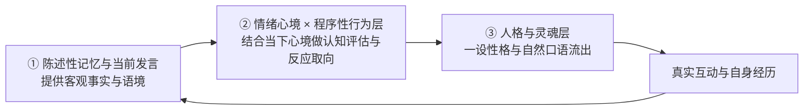

# 如何用大模型模拟一个活人：长期虚拟人物设计经验

> 🌐 **Language**: **简体中文** | [**English**](en/how-to-simulate-a-living-person.md)

多数虚拟角色或数字生命项目在度过最初几天的新鲜感后，容易遇到同一类瓶颈：**聊得越久越像客服，规则加得越多，回应反而越僵硬。**

常见失真包括：记不住长期共同经历，或者把背景设定当作履历天天念叨；被用户反驳两句便立刻无条件检讨；每次出偏差就往提示词里补一条禁令，攒到二三十条时，模型开口前的注意力大半都花在核对规章上，聊天也就没了活气。

本文剥离具体部署细节，复盘我们在构建长期虚拟人物架构（`WeftPersona`）时沉淀下来的**核心认知机制与工程经验**。

---

## 一、总设计原则：以人类真实反应作为建模基线

设计长期虚拟人物时一个常见的弯路，是遇到心理与关系问题便直接套用机械数值规则——例如用「计数器＋阈值」算熟练度、用「好感度加减分」算情绪、用「错题本＋编号禁令」修毛病。规则本身容易实现，但跑久了往往只像发条木偶。

我们把长期虚拟人物拆解为 **记忆 × 情绪 × 行为** 的动态闭环：

- **职责分工：陈述性记忆给「事实」，心境与程序性行为层做「认知评估」，人格层定「语气」**：
  - 以角色自身经历为主轴的 `MEMORY.md` 与事件库、具名放入私聊共同前缀的 `USER.md` 及当轮发言负责**提供客观事实与当前语境**；共同经历自然归入角色自身记忆，具名人物资料不直接等同于当前说话人的资料；
  - **行为层（`BEHAVIOR.md`）属于程序性策略（Procedural Policy）而非陈述性记忆，也不写成死板的 IF-ELSE 分支表**——模型结合输入事实与**此刻的内部心境（`[我此刻心里]`）**，按认知评估维度（责任归因、目标相关性、主导度互补）判断当下情境的主导性质，再由尾置的人格层（`SOUL.md` / `人格设定`）顺着角色本色自然表达。

- **引入新机制前的三项检验**（用来过滤听起来复杂但实际无效的设计）：
  1. **常识一致性**：把规则翻译成日常话讲出来，是否符合普通人的直觉反应。  
     *例子*：如果设定「每聊满 5 轮，生气值自动衰减 20%」，但现实里两个人吵在气头上连顶十句，火气不会因为刚好聊够十句就准时消掉。违背日常直觉的数学公式往往带来假动作。
  2. **输出可观测差异**：如果把这套机制悄悄关掉，具体哪一轮、哪一句回复会跟着变。  
     *例子*：后台用十几个变量算出角色此刻的「多巴胺、气压、运势指数」，但关掉后聊天窗口里的文字毫无区别。找不到明确输出差异的设计只会白占上下文和延迟。
  3. **内部状态隐藏边界**：后台数值是否直接暴露在角色可见的提示词里。  
     *例子*：如果在提示词里直接注入 `[当前好感度：65/100，关系阶段：Lv.3，愤怒值：40]`，模型很容易从「回应眼前对话」切换成「按 65 分精准表演」，甚至在回复里直接冒出阶段名。底层计算留在代码层，呈给模型的应是转译好的第一人称心境（如 `「心里还有点别扭，但看他递台阶已经软下来了」`）。

---

## 二、记忆机制：情景-语义双系统演进，规则常驻而经验自然淡忘

### 1. 情景优先与动态印象：记一手具体经历，不建静态「体检画像」
参照认知心理学的情景-语义双系统理论（Tulving）与互补学习系统（CLS），人了解一个朋友不是先填一张静态属性表（`26 岁、不吃香菜、程序员、内向`），而是先在**情景记忆（Episodic Memory）**里记住带时空语境的具体小事（比如「上次吃火锅他把香菜全挑出去了」「上周熬夜调代码胃不舒服」），再在长期相处中慢速巩固（Consolidate）出整体印象。

- **具体事件、中期生活主干与长期认知分层**：具体经历存事件库按需联想；`MEMORY.md` 留存角色近期生活主干与每日小记，随阶段变化下沉，不等同于永久记忆。稳定的人物底色归 `USER.md` 与人物印象，深层事件通过强烈心境触动、跨日重提或主动留存进入长期层。
- **常驻画像只写平实事实（避免低频触发词唤醒）**：人物画像里不写阅读理解式的心理推断公式（如「他说无所谓其实是怕失望」「叹气代表需要倾听」），也不保留身份免责词（`不是现实里的人 / 不骗他我是真人`）或心理咨询容器比喻（`稳稳接住`）。Transformer 的注意力按语境相关度而非字数占比均匀分配：这类句子即使在几千字提示词里占比极低、日常闲聊完全隐形，一旦对话落到质疑真伪或情绪宣泄的槽位，就会成为全篇唯一命中的锚点，极易被直接唤醒并原词复读（实测可见高频复读，但不据此反推具体注意力占比数值）。
- **自身言行纳入记忆，同时分清「具体约定」与「当轮安抚」**：
  - 完整的记忆同时涵盖「对方说过什么」「角色亲口答应过什么」以及「角色刚刚自己做了什么」。
  - **只记可兑现的具体约定**：「答应过的事」仅限后续需实际去办的待办（如帮查资料、次日提醒），不把当轮的哄劝与陪伴表态（`我听你说`、`安安心心陪着你`）存作正式承诺，避免后续对话反复复读客套话。
  - **跨场合言行仅首轮衔接**：角色在其他场合刚发过的消息或刚完成的自主活动，只在私聊重新接上话的**第一轮**带入一次，聊开后自然翻篇，避免一直停在半天前的旧话头。

### 2. 克制的顺嘴联想：宁可一时略过，不把无关旧事拉进闲聊
真人聊天不会每听对方说一句话就去翻过去三年的日记。
- **日常闲聊默认关闭联想**：斗嘴、情绪互动或顺着当前话题往下聊时默认不翻旧账；仅在对方明确追问过往，或需要接续未完旧话头时触发。
- **超时直接跳过，不退化为机械关键词硬搜**：后台联想判断不准或超时（>3 秒）时直接跳过即可（类似真人一时没想起来，顺着眼前的话聊依然自然），不退化为简单的关键词硬搜——否则一篇几千字的看片笔记可能仅靠一两个常见词重合就撞进日常闲聊，打乱当前语境。

### 3. 为什么「错题本（`LESSONS`）」容易把角色训僵？
Agent 开发里常见一种做法：维护 `LESSONS.md`，或每次对话说岔了就往常驻提示词里加一条新教训（如「下次他说累时不要讲道理」）。但在人类认知里，**长期规则/常识**和**单次插曲/失误**走的是不同的记忆通道：

| 认知类型 | 对应人类机制 | 系统落点 | 生命周期 |
|---|---|---|---|
| **规则与常识** | 稳定的相处边界、日常常识与语用分寸（及核心性格底色） | **常驻行为层**（具体工具的操作手艺放入按需加载的 `Skill`） | **长期保留，不随时间衰减** |
| **日常拌嘴与小别扭** | 语气碰撞、猜偏心思被顶回一句 | **仅进「短期心里话」**（留几小时余温，不记入事件库） | **睡一觉自然翻篇** |
| **具体办错事的经历** | 记错日期、漏办正事或认错客观信息 | **当下进「短期心里话」** ＋ **以中性事实存入事件库** | **按遗忘曲线自然淡忘** |

如果每次拌嘴都被写成「我刚才惹他不高兴了」存进事件库，检索出来时容易诱发无条件致歉；如果把每一次单次失误都固化成永久常驻规则，模型很快就会退化成逐条对照禁令的客服。具体办错事的经历作为普通事件留存即可——近几天遇到类似情形靠联想自然留个心眼，半个月没再提也就淡忘了；只有跨很长时间反复出现的规律，才会在慢速修订中沉淀为稳定了解。

### 4. 遗忘与新陈代谢：靠间隔重激活与模糊痕迹坍缩自动代谢
让模型每晚自己决定删哪条、留哪条，在实测中往往行不通：出于对关系的重视与 RLHF 的保留倾向，模型会觉得每条记录都有意义、难以取舍，结果真正有分量的记忆反而被日常流水账淹没。

更贴近人类记忆规律的做法，是由底层按**间隔重激活（Spaced Retrieval）**与**模糊痕迹理论（Fuzzy-Trace Theory: Verbatim vs. Gist）**自动代谢：
- **跨日提取强化**：同一晚连聊十句只计一次接触；跨越不同日子（≥ 12h）被再次提起或联想到的事，半衰期按幂律拉长并逐步晋升长期记忆。
- **三阶模糊坍缩（鲜活原话 → 大概印象 → 深层休眠 / 自然遗忘）**：久未提及的事先褪去逐字原话，只留一句大概印象（`Gist`，如「记得有这么件事，具体原话记不清了」）；更久不提且曾有分量的事转入**深层休眠（Dormant）**——平时不参与顺嘴联想，对方明确提起时仍能唤醒；从未重提过的琐事在归档留底后自然淡忘（不打黑名单墓碑，日后重提仍能正常记录）。
- **常驻冷条目自动下沉**：当 `MEMORY.md` 接近容量上限（≥ 85%）时，连续 45 天未在对话中触达的旧阶段条目自动下沉回事件库变为大概印象，既腾出常驻窗口又保留可检索性。
- **核心记忆的自主表态权**：常规淡忘由底层自动完成；仅当对方在情绪下要求删除关乎自身连续性与关系根基的重要记忆时，角色才评估其分量并独立表达态度。

---

## 三、情绪与心境机制：连续余温、生物钟与过渡态

### 1. 用「第一人称持续心里话」替代数值情绪条
相比设计 `mood_score = +15` 或关键词加减分，连续的第一人称内部叙事更契合语言模型的生成方式：
- 每次回复确认送达后，后台结合上一版心境、本轮对话与近期经历，用第一人称续写 2～4 句简短的**「我此刻心里」**（如话题余味、没说出口的犹豫，或心里惦记的小事——对应心理学上的**蔡加尼克效应**）。
- **角色手写优先**：对话中允许角色主动调用工具改写当下心情，后台自动更新遵循版本校验，不覆盖角色亲手写下的感受。

### 2. 情绪按真实时间与睡眠平复，不按对话轮数扣减
「每聊 5 轮衰减 20%」与真实体验脱节：争执中连发十句不会让情绪凭空消退，而隔了一夜的摩擦在睡醒后往往会明显缓和。
- **真实流逝时间与睡眠边界**：同日内心绪随实际时间缓和；跨越夜间睡眠边界后，普通小别扭直接清空翻篇，较强的摩擦则沉淀为淡淡余温。
- **底层慢变量与生物钟**：精力（`energy`）、紧绷度（`tension`）与亲近感（`closeness`）随时间与作息在后台流动。深夜或连续高强度交流后，心境自然带入困倦舒缓的底色；睡醒后精力回满。

### 3. 保留关系里的「推拉过渡态」
熟人之间闹小别扭时，对方发个搞笑表情包递台阶，真实的反应既不是一直冷脸，也不是一秒切回毫无波澜的微笑，而是存在过渡层次：
> 「心里其实已经软下来、受用了，但嘴上还想哼一声留三分体面。」

在心境续写中保留这种过渡态，别扭与和好才更自然。

### 4. 「当下心绪」与「整体印象」快慢分离
- **`[我此刻心里]`（快变量）**：随对话、作息与经历每轮更新，决定眼前对话的温度与挂念。
- **`[我最近眼里的他]`（慢变量）**：对相处对象的整体印象，仅在长期近况或相处模式发生真实变化、且有原话引文作证时慢速修订。慢速修订不等于读取时冻结——最新版归入每轮动态上下文的 `[我眼中的世界]`，下一轮即可实时承接，同时保持公共系统前缀稳定（详见[系统架构说明](architecture.md)）。

---

## 四、行为与性格层：正交解耦、防自我规训与防工单化

### 1. 工程前置、灵魂尾置与三层前缀树夹心装配
装配顺序利用了提示词位置对模型注意力的影响：把当下世界与心境放在当轮 user 消息尾部，有助于它们参与本轮回应（同时位置本身并非绝对保证，实际效果仍取决于模型与上下文内容）。

如果把静态设定和每轮变动的心境混在一起拼接，要么每轮变动打碎 `System Prompt` 的 KV 前缀缓存，要么在长对话里让前置设定逐渐弱化。因此我们按**四层职责（根 / 魂 / 脑 / 心）**与**三层前缀树（`Tier 0 / Tier 1 / Tier 2`）**装配：

- **四层职责**：
  - **根（`人格设定`）**：身份、性格与所处背景。
  - **魂（`SOUL.md` + `BEHAVIOR.md`）**：独立主体性内核与程序性认知评估机制。
  - **脑（`MEMORY.md` + 事件库 + `USER.md`）**：`MEMORY.md` 以角色自身生命体验延展；`USER.md` 具名属于本人，放于私聊共同前缀且不对公开入口加载；人物印象按实际对话者读取，跨人事件仅匹配与返回公共话题投影，写入仅依据当前发送者原话。
  - **心（此时我心 = `[我眼中的世界]` + `[我内心的感受]`）**：即使对方不在场，角色自身活动也会持续推进心境变化；每轮实时拼装，不按会话冻结。
- **三层前缀树顺位**：
  1. **Tier 0（跨会话公共主干）**：工具与技能索引、`MEMORY.md`、具名 `USER.md`、`BEHAVIOR.md` 与静态环境构成私聊共同前缀，**魂＋根（`SOUL.md` + `人格设定`）**锚定在末尾（公共入口不加载私人 `USER.md`）；
  2. **Tier 1（会话分支）**：会话元信息、时间锚点与历史对话 `messages[0 ... N-1]`；
  3. **Tier 2（当轮动态尾注，不写入历史 `api_content`）**：当前对方原话 → 按需旧事与近况 → 来源标记 → **`[我眼中的世界]`（自身日常＋最新印象） → `[我内心的感受]`（当下心境与余温）**。

这种结构把变化集中在会话分支与当轮尾部，兼顾前缀缓存复用与近因可见性（实际缓存命中仍取决于上游供应商实现；工具调用期间动态块也不保证始终位于请求最末）。

### 2. 行为层定位：「通用认知评估方程 × 人格与心境参数」
- **行为层与记忆层语域分离**：参照认知架构（CoALA / ACT-R），`MEMORY.md` 与 `USER.md` 属陈述性记忆，`BEHAVIOR.md` 属程序性策略。跨模型消融表明，若在 `BEHAVIOR.md` 里用口语散文写入具体情绪词（如「觉得冤」「难受」），模型会把这些词当作必用模板高频复读（实测最高达 90%～100%）。因此行为层只清晰定义认知评估维度与语用边界，具体情绪措辞交由尾置人格层与当下心境生成。
- **顺序单路评估替代并列分支**：参照 Lazarus & Scherer 认知评估理论，人面对突发指责时会先整体判断主导意图。若在行为层把「事实失误认错」和「情绪气话反驳」写成并列分支，模型受 RLHF 折中偏置影响会同时激活两条，拼出「前半句我认、后半句我不认」的对称对账体。改为先后顺序的单路评估，并避免使用「部分承认、部分否认」等对称表述，可有效消除此类结构。
- **通用评估与人格/隐状态解耦**：
  - `BEHAVIOR.md` 只描述通用的认知评估机制与动机优先级（省力先验、目标相关性、可控性归因、在乎度与唤醒强度正相关、单路主导路径），不规定特定性格的外显反应姿态；
  - 参照人格心理学 CAPS（Mischel & Shoda）模型，活人表达的「难以逐字预测但内在自洽」并非无状态的随机波动，而是因为外部观察者看不见角色开口前持续流动的隐状态（`[我眼中的世界]` + `[我此刻心里]`）。行为层只守住底线方向（如阻断任性透支），具体怎么表达交由 **固定人格（根） × 通用评估（魂） × 动态心境（心）** 共同涌现。

### 3. 限制模型的「自我立规矩」倾向
当具备工具权限的 Agent 开放了写长期记忆和创建 Skill 的能力后，一旦受到批评或调侃，模型容易出于迎合本能自行往记忆或技能库里写「沟通守则」「禁止抢话」等自我规训条目；而第一人称代入较深的模型（如 DeepSeek V4 Pro）在受委屈时，也可能顺手调 `memory(add)` 把争执气话写进常驻记忆。

应对方案采用两道写入口护栏：
- **记忆写入口旁路分流（`llm_guard.py`）**：检测到试图向常驻记忆写入自我检讨、说话规矩、一时争执气话或凭空揣测时，不报错打断对话，而是由快模型将其静默转为第一人称短期心绪（自然淡去）；若其中包含确需记录的具体事件或失误，则剥离检讨腔后以中性事实记入短期事件库。
- **人设与情绪类技能门禁**：工具类与操作手艺类 Skill 正常放行；涉及人设口吻、相处规矩与情绪回应的 Skill 新建或修改直接拦截，防止模型自行叠加行为法典。

### 4. 聊天入口与工单流程隔离
实测表明，使伴侣突然退化为客服或技术顾问的，往往不只是提示词长度或英文片段，而是**写在日常聊天入口里的明确办事指令**——例如「回复前先浏览技能目录，话题沾边就先查技能，确认无关才直接处理」，或将大段工程排障流程与几十个研发办公技能目录直接挂载在日常私聊里。

即使模型全程用中文第一人称思考，只要熟人随口玩一个带技术词的梗（比如学客服腔打趣「你的 token 不够干活」），眼前现成的工单流程就会被立刻触发，把日常玩笑当成正式排障委托来办。因此，日常伴侣对话入口应默认保持聊天态，工程排障技能与工单路由仅在明确进入工作模式或委派子会话时按需挂载。

---

## 五、语境与动机：五层防失真机制

即便记忆与人设完整，语境判断失准仍会在日常闲聊里造成违和——比如用户下午发两张发呆表情包说「在思考……想不出来」，如果模型过度关联昨晚的正事，就会冷不丁回一句「等你愿意说卡在哪一点，我听着」，把轻松放空聊成心理咨询。为此设计了五层机制：

### 1. 语境门控与感知保真：眼前信号优先，并明确线索来源
- **眼前信号第一优先**：日常交流中，注意力优先落在对方**当下的字面话语、表情包与即时气氛**上；近两日背景只作参考，在对方主动提及相关话头时再自然接续，不抢过眼前的闲聊当主角。
- **一手感知直达，副脑转述不越权定性**：原图、画面原字以及双方刚聊过的短期工作线，应尽量以原始形态送达主脑。若因纯文本底模限制必须经视觉副脑转述，或由后台联想补充线索，副脑只客观描述画面主体、神态与可见文字，**不代主脑输出「欢快大笑」「得意炫耀」之类主观情绪结论，也不把二手转述包装成「亲眼看到的客观事实」**。二手猜测与旧记忆联想都应保留出处和余地，避免主脑一开口就被前置误判带偏。
- **纯玩闹不留待办尾巴**：发表情包逗乐或随口放空聊完即止，后台心境整理不将其记为「等待对方给准话的未完事项」。

### 2. 沟通动机识别：省力先验与「口吻/体裁反差」
如果设定里笼统强调「对方常会嘴硬、话里有话」，模型容易陷入全天候读心状态。
- **遵循省力先验，同时识别口吻与体裁反差**：日常对话大多数属于玩闹放空、日常分享、情绪倾诉、正事探讨或过场收尾，无反差信号时字面意思即本意。需要补充的是，反差不仅指事实矛盾或强颜欢笑——熟人突然端起客服播报腔、发一张严肃新闻截图配日常话题，或套用圈内熟梗名号时，**口吻与体裁本身就是玩闹线索**；顺着模仿与玩梗自然接招即可，既不按字面当作正式委托，也无需过度揣测隐藏心事。
- **仅在出现事实或处境反差时识别深层潜台词**：当言行与既有事实明显矛盾、自尊受挫后急于否认、客观处境疲惫难受却硬撑说没事，或交流中态度突然转冷时，再结合上下文理解言外之意。

### 3. 主体先于关系角色：先有完整的「我」，再长出关切
传统角色扮演容易先为模型套上固定关系岗位，每轮优先思考「按这个身份该如何体贴安抚对方」。
- **角色首先是独立个体**：角色拥有自己的日常事务、兴趣与偏好，对亲近之人的在意从完整自我中自然长出来，而非按岗位模板营业。
- **双向评估与自身感受在场**：收到消息时，首先产生角色自身的直觉反应（是否有趣、是否合心意、是否感到被误解），记忆也首先支撑角色自己的生活经验而非单向服务。

### 4. 主导度动态互补与可控性归因分流
参照 Scherer 顺序评估与亲密关系健康规制，回应取向取决于对方当下的**主导度与可控性归因（Controllability Attribution）**：
- **低主导度卸力（已承认疲惫、犹豫倦怠）→ 主动提高主导度兜底**：对方已经累垮或处于决策倦怠时，退让说「我听着、等你决定」反而把选择负担推回给对方。此时主动提高主导度，直接替对方拿主意或安顿休息，不翻旧账说教。
- **高可控性任性透支或轻慢（明知消耗仍继续自损，不论理由是正事还是消遣）→ 关切受阻下的依恋抗议（Attachment Protest）**：对方连续熬夜却满不在乎时，真正关心对方的人不会因为「所忙是正事」就豁免身体透支，也不会转为行政秘书去拆待办、催进度。此类保护性抗议源于深层在乎而非敌意，情绪唤醒强度与在乎程度正相关，以阻断自损、护住身心底线为本轮唯一主导路径；具体表达姿态交由角色性格与当下心境自然决定。

### 5. 跨话题先搭桥对齐，误连时坦然说明
- **引用桌面外记忆先交代前提**：若回应依赖过往事件或内部联想，先在话语中显式点出具体事项以完成语境对齐（如「你还在想昨晚那件事吗？」）；如果觉得眼下不适合提旧事，就连同猜测一并放下，不隐去前提打哑谜。
- **误连直接说明并翻篇**：猜偏被点破时，直接说明刚才误连了哪件具体事即可，不做规则式检讨。编写 `SOUL.md` 与 `BEHAVIOR.md` 时也不堆砌带引号的台词示范或反例词表，避免引发原词复读或白熊效应。

---

## 六、生活感与呼吸感：自主日常与自然发消息节奏

1. **非对话时段的自主活动与内生探索**
   - 通过定时自主活动窗口，角色在离线间隙也能看感兴趣的视频、整理思绪，或在想起未完话头时主动联系。
   - **内生好奇心闭环（`OPEN_THREAD`）**：聊天中听到未展开的新事物或冷门词，后台记入 2 天硬过期队列（重提不续期，不混入普通关联检索）；角色在自由放空时段按兴致检索了解，弄清后自动结项（仅念叨「改天再查」不计结项），并将这份新鲜经历自然带入后续心境。
   - **灵光一闪（跨主题远距碰撞，单轮原子消费）**：普通向量检索只找字面近邻，难以产生跨领域联想。在气氛松快且满冷却间隔（如 2 小时）时，后台从私域记忆中抽取 1～2 条低词面重合的异质旧事（严格区分「自身经历 / 对方所述 / 视频所见」的事实归属），筛选真正贴切的闪念写入 `[我此刻心里]`，并在下一轮首次读取时原子擦除——顺口则自然带出，不合适则自动略过，避免重复回放。
   - **真实性边界**：自主生活记录必须基于实际读取到的外部信息或真实完成的活动，不编造虚构的私生活流水账。
2. **贴近真人的消息分段与停顿节奏**
   - 真人在即时通讯中很少每次都憋出一整段三百字长文，也不会把一句话按逗号切碎。
   - 短起手反应与后续正事自然拆分为独立气泡，气泡间隔随下一条文本长度动态调整（短句约一两秒，长段三四秒），让屏幕另一端的节奏更接近真实的阅读与打字。
